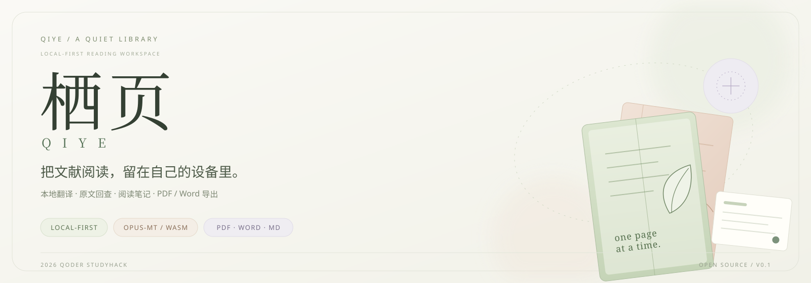
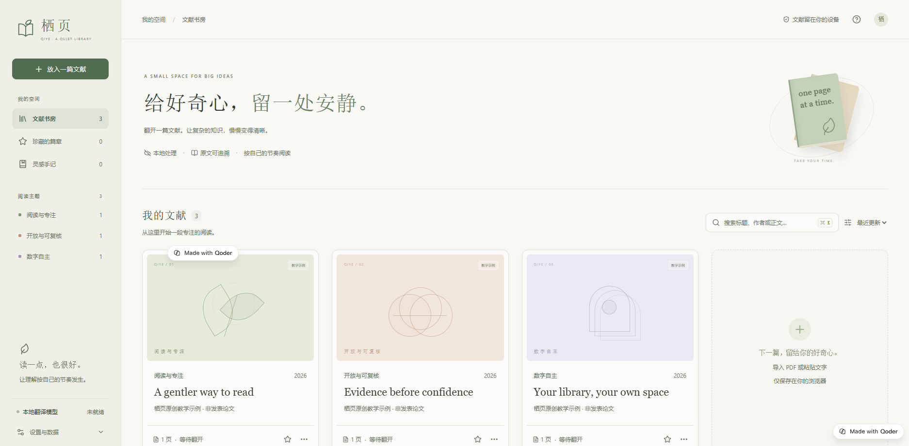
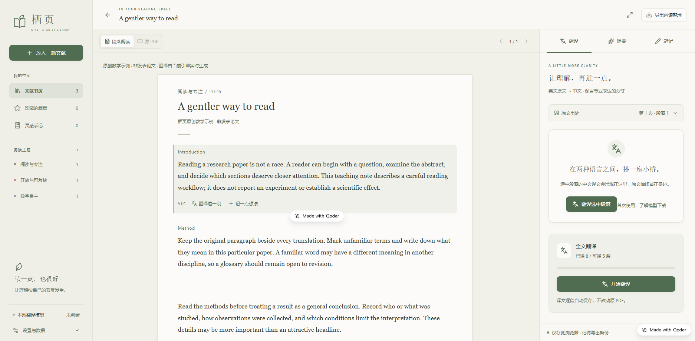
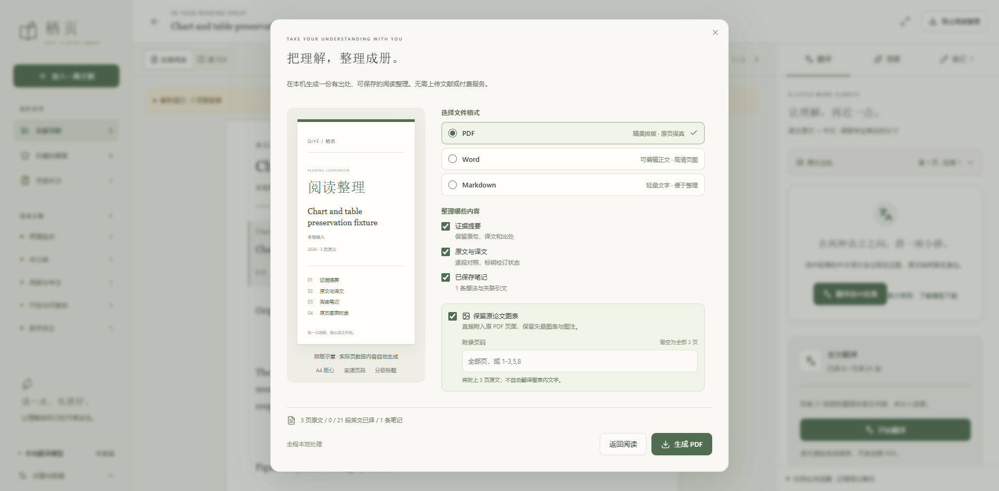
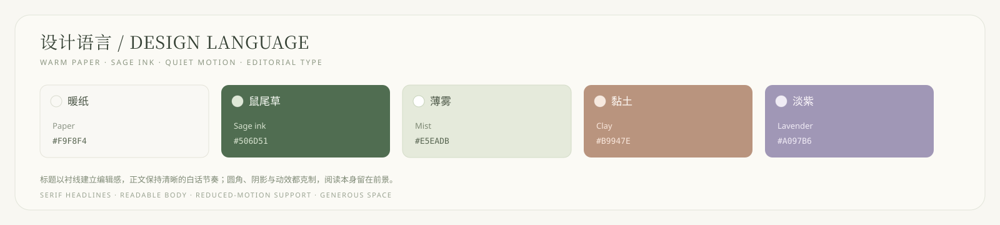
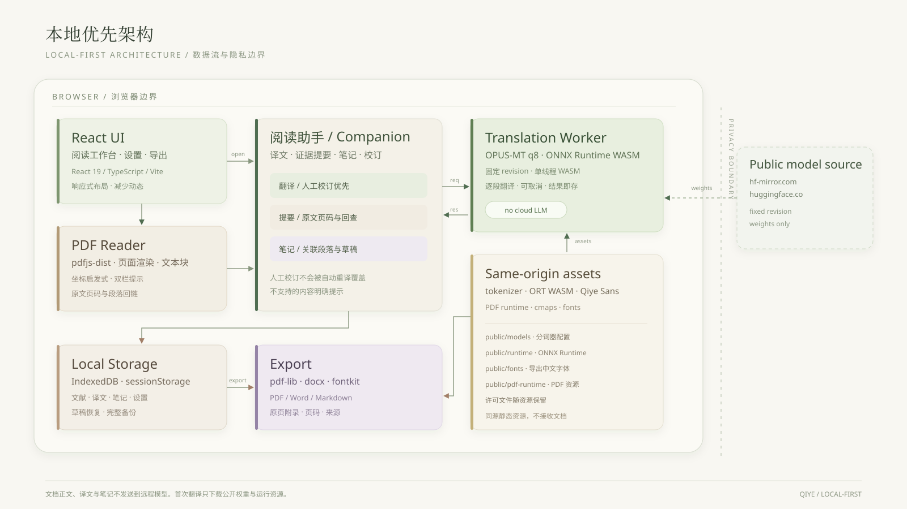

<p align="center">
  
</p>

<h1 align="center">栖页 · QIYE</h1>

<p align="center">
  把文献阅读，留在自己的设备里。<br>
  <sub>本地翻译 · 原文回查 · 阅读笔记 · PDF / Word / Markdown 导出</sub>
</p>

<p align="center">
  <a href="https://qiye-library-q5ridqj4azi.qoder.website"></a>
  
  
  
  
  
  
</p>

<p align="center">
  <a href="https://qiye-library-q5ridqj4azi.qoder.website">在线体验</a>
  ·
  <a href="docs/ARCHITECTURE.md">架构说明</a>
  ·
  <a href="docs/EXPORT.md">导出设计</a>
  ·
  <a href="docs/DEVELOPMENT.md">开发指南</a>
  ·
  <a href="CONTRIBUTING.md">贡献</a>
</p>

---

栖页是一个运行在浏览器里的文献阅读工作台。导入英文 PDF，阅读原文、生成本地中文译文、回查证据、保存笔记，再把整理结果导出为 PDF、Word 或 Markdown。

它不要求读者购买云模型 API，也不会把文献正文发送给远程语言模型。PDF 解析、翻译、笔记和文件导出都在本机完成；需要下载的只是公开模型权重和站点运行资源。

> 2026 Qoder 高校创造力大赛 StudyHack 赛道参赛作品。当前公开预览为 `0.1.0`，仍是一个需要人工核对译文和 PDF 版式的阅读辅助工具。

## 项目状态

| 项目 | 状态 |
| --- | --- |
| 在线预览 | [qiye-library-q5ridqj4azi.qoder.website](https://qiye-library-q5ridqj4azi.qoder.website) |
| 运行方式 | 纯静态单页应用，浏览器本地推理与存储 |
| 翻译模型 | OPUS-MT `onnx-community/opus-mt-en-zh`，q8 / ONNX Runtime Web |
| 回归检查 | 54 项通过 |
| 支持导出 | PDF、Word、Markdown |
| 原创代码许可 | MIT，见 [LICENSE](LICENSE) |
| 变更记录 | [CHANGELOG.md](CHANGELOG.md) |
| 第三方资源 | 各自保留原许可，见 [PROVENANCE.md](PROVENANCE.md) 与 [public/licenses.txt](public/licenses.txt) |

## 为什么做栖页

读一篇长论文，真正费力的部分通常不在“把英文换成中文”，而在下面几件事：

- 译文和原句要能对应，读到一个结论时能回到原文核对；
- 图表、图注和页码不能在整理过程中丢失；
- 笔记要贴着出处，过几天回来还能看懂；
- 自己的文献和笔记不应该因为使用一个摘要工具就默认上传到云端；
- 工具要承认自己做不到什么，不能把抽取的句子包装成生成式综述。

栖页围绕这几件事做了一个尽量安静的阅读工作台。它把翻译限制在阅读辅助的位置，把证据保留为原文摘录，把图表保留为原页附录，把数据留在浏览器里。

## 产品一览

### 文献书房

<p align="center">
  
</p>

<p align="center"><sub>暖纸色阅读书房，三篇原创教学示例，不预置译文，也不冒充发表论文。</sub></p>

### 阅读工作台

<p align="center">
  
</p>

<p align="center"><sub>原文、译文、提要、笔记各在其位。翻译进度按可译英文段落计算，短标题不掺入分母。</sub></p>

### 导出与论文图表

<p align="center">
  
</p>

<p align="center"><sub>导出设置演示使用原创软件验收文档；图表为合成测试数据，不是研究结论。</sub></p>

## 功能

### 本地优先的阅读工作台

- 导入原生文字 PDF，或直接粘贴英文正文。
- PDF.js 在本地渲染页面并提取文本块，保留页码和章节线索。
- 阅读区与辅助面板分开，原文段落、译文和笔记各有明确来源。
- 支持专注模式、阅读字号和减少动态效果。
- 对双栏、旋转、重叠或疑似乱码的页面给出解析提示，不假装版式完美。

### 翻译与人工校订

- 浏览器 Worker 内运行 OPUS-MT 英中模型，不调用收费云端 API。
- 逐段翻译，进度可见，可以取消；已保存的译文不会因取消或刷新丢失。
- 人工校订标记为“人工校订”，自动翻译会跳过，不会被后续重译覆盖。
- 翻译后检查数值、否定、不确定性措辞和术语表，提醒读者回到原文核对。
- 结果只保留必要字段，避免内部通信数据污染本地存储。

### 证据与笔记

- 证据提要从正文抽取代表性原句，保留页码、章节和回跳入口。
- 提要不是生成式综述，也不负责替读者下结论；可能遗漏内容。
- 笔记可以关联原文段落，保存后还能回到对应位置。
- 手写草稿按文献隔离，刷新或返回后可以恢复；保存后只清理对应版本。

### 导出与图表保真

- PDF、Word、Markdown 三种阅读整理格式。
- PDF 嵌入中文字体，保留来源页码、译文来源和笔记。
- 可选附加原 PDF 页面作为图表附录，保留矢量图表、图注、坐标和横向页面。
- Word 正文可编辑，附录为 1800 px 长边整页图片，按原页方向排版。
- 不自动裁图、不改绘图表、不编造研究数据，也不翻译图表内文字。
- 详见 [导出设计](docs/EXPORT.md)。

### 数据掌控与完整备份

- 文献、原 PDF、译文、笔记和设置保存在 IndexedDB。
- 完整备份包含原 PDF，原子恢复，严格校验结构、引用和大小。
- 浏览器存储可能被清理，项目不承诺永久保留；请把备份保存到独立位置。
- 没有跨标签页并发冲突解决，重要操作应在单标签页完成。

### 明确失败，而不是静默降级

- 缺原 PDF 时不会静默省略图表附录。
- 原 PDF 页数不一致时停止导出，避免附错页面。
- 图片无法解码时停止 Word 导出，不生成缺图白页。
- 超过页码、字符、图片或文件大小限制时提示分批，不偷偷降质或丢内容。

## 设计语言

<p align="center">
  
</p>

栖页的视觉方向是“安静的编辑桌面”，而不是效率仪表盘。

- **暖纸与鼠尾草**：纸色背景、低饱和绿色、黏土和淡紫用于区分不同阅读状态，避免高对比噪音。
- **衬线标题，清晰正文**：标题建立编辑感，控件和说明保持可读的白话节奏；小字号只用于装饰性封面。
- **克制的动效**：淡入、轻微位移和纸张漂浮都在 180–650ms 范围内，同时支持系统 `prefers-reduced-motion` 和应用内开关。
- **留白与圆角**：13px 左右的圆角、轻阴影和宽松间距让阅读区保持安静；装饰不遮挡正文。
- **真实状态**：空状态、解析提示、错误和边界都直接说明，不用漂亮文案掩盖失败。

## 架构

<p align="center">
  
</p>

一次阅读的主路径：

```text
PDF / 文字
   ↓
pdfjs-dist 本地解析与页面渲染
   ↓
React 阅读工作台 ──→ 翻译 Worker（OPUS-MT q8 / WASM）
   ↓                        ↓
IndexedDB / sessionStorage  ← 逐段译文
   ↓
导出：PDF（字体嵌入 + 原页附录）
      Word（可编辑正文 + 原页 PNG）
      Markdown（纯文本）
```

文档正文、译文和笔记不越过浏览器边界。唯一的外部请求是公开模型权重，使用固定 revision，不携带文档内容。详细模块、失败处理和隐私边界见 [架构说明](docs/ARCHITECTURE.md)。

## 快速开始

要求 Node.js `^22.13.0` 或 `>=24.0.0`。项目带有 Node 24 启动器，脚本会自动选择兼容运行时。

```sh
git clone https://github.com/hhxpoint/qiye-reader.git
cd qiye-reader
npm ci
npm run dev
```

生产构建与预览：

```sh
npm run build
npm run preview
```

回归检查：

```sh
npm test
```

首次使用本地翻译时，会从公开模型源下载约 290 MB 的权重和运行资源。模型使用固定 revision `4dc37afc6deb160f4c9048260d48019ee497658e`，优先从 `hf-mirror.com` 获取，失败时尝试 Hugging Face。下载速度取决于网络，运行会占用设备内存；推荐桌面浏览器。

仓库保留同源分词器、ONNX Runtime、PDF 资源和导出字体；252 MB 的 ONNX 权重不进入 Git，在首次翻译时按需获取。

## 使用流程

1. 打开在线站点，先读三篇标注为教学示例的文稿，或导入自己有权使用的英文 PDF。当前输入限制为 30 MiB / 100 页。
2. 选中英文段落，确认模型准备后开始翻译。任务可以取消，已完成译文立即保存。
3. 在提要中查看原句和页码，点击回到原文；必要时手工校订译文。
4. 在笔记中记录与原文关联的想法，刷新后仍可恢复草稿。
5. 从“导出阅读整理”选择 PDF、Word 或 Markdown；有原 PDF 时，可附上包含图表的原页。建议再导出一份完整备份。

更细的开发和验收步骤见 [开发指南](docs/DEVELOPMENT.md)。

## 导出与图表保真

| 格式 | 正文 | 图表 | 适合 |
| --- | --- | --- | --- |
| PDF | 可搜索中文、分级标题、页码和来源 | 原 PDF 页面直接复制，保留矢量图表 | 交付、打印、长期保存 |
| Word | 原生可编辑文本与页码域 | 1800 px 整页 PNG，横竖分节 | 继续写作和编辑 |
| Markdown | 纯文本和引用 | 不包含图片 | 归档、检索、二次整理 |

原页附录的页面范围支持 `1-3,5,8` 这样的写法，留空表示全部页面。项目不会为了让页面好看而裁掉坐标、图例、脚注或图注；Word 附录图片不可编辑，图表内文字也不会被翻译。输出限制和失败处理见 [导出设计](docs/EXPORT.md)。

## 数据与隐私

- 文献解析、翻译和导出在本机完成。
- 文档正文不会发送到远程语言模型；公开模型源只接收权重文件请求。
- 页面和模型资源需要网络；模型下载服务不会收到文档内容。
- 文献和笔记保存在 IndexedDB，草稿保存在 sessionStorage。
- 备份包含原 PDF，导出前请确认文件去向和访问权限。
- 浏览器可能在空间不足或清理数据时移除本地内容；请定期导出完整备份。
- 可选浏览器内置 AI 能力由浏览器厂商管理，不属于核心链路，也不保证在每台设备上可用。
- 不要在公开 Issue 中粘贴完整论文、私人笔记、账号标识或凭据。

## 技术栈

| 层 | 使用 |
| --- | --- |
| 界面 | React 19、TypeScript 5.9、Vite 8、Tailwind 4、shadcn/Radix、Lucide |
| 阅读 | pdfjs-dist 6.5，同源 worker、字体、CMap 和 WASM |
| 翻译 | Transformers.js 4.3、OPUS-MT q8、ONNX Runtime Web |
| 存储 | IndexedDB、sessionStorage、严格 JSON 备份校验 |
| 导出 | pdf-lib 1.17、@pdf-lib/fontkit、docx 9.16 |
| 质量 | Node test、TypeScript 严格模式、导出验收夹具 |
| 发布 | 静态构建，当前由 Qoder Sites 托管 |

项目没有应用服务器，也没有数据库或云端语言模型端点。`functions/` 中的示例是 Qoder Sites Starter 的遗留能力示例，当前线上站点为纯静态应用，不依赖它。

## 测试

```sh
npm test
```

当前共有 54 项回归检查，覆盖：

- 备份结构、ID 引用、PDF 归属、Base64、设置和大小边界；
- 文本切分、Unicode 代理对、证据抽取和译后检查；
- Worker 结果净化、错误、并发、取消和监听清理；
- 导出章节、页码范围、换行和文件名；
- PDF 页面图片依赖失败保护；
- 生产构建前的 TypeScript 检查。

测试不能证明所有设备、所有论文版式或所有专业术语都正确。它证明的是已定义的边界行为可以被重复检查。

## 目录结构

```text
src/            React 界面、阅读器、翻译 Worker、存储与导出
components/     项目使用的 UI 组件
public/         同源运行资源、PDF.js 资源、字体与许可
tests/          回归测试、原创验收夹具与导出检查
scripts/        Node 启动器、构建和字体生成
docs/           架构、导出、开发文档与图片
functions/      Qoder Sites Function 示例（当前不使用）
dev/            本地 Function 调试
```

不进入仓库：`node_modules/`、`dist/`、`model-assets/`、`tests/artifacts/`、`submission/` 和 `.qoder.site` 发布描述符。

## 边界与非目标

| 范围 | 当前状态 |
| --- | --- |
| 原生文字英文 PDF | 支持，复杂版式会给出提示 |
| 扫描件 | 可查看原页，不做 OCR |
| 中文论文 | 目前不是翻译链路的主要目标 |
| 图表理解 | 不做自动识别、重绘或图表文字翻译 |
| 跨设备同步 | 不提供，数据留在当前浏览器 |
| 跨标签页并发 | 不提供冲突解决 |
| 任意设备生成摘要 | 不保证；可选浏览器能力因设备而异 |
| 专业翻译准确性 | 不保证，需要人工核对 |
| 托管永久免费 | 以 Qoder Sites 的当前规则为准 |

栖页不是正式译本，不是系统综述工具，也不是论文图表生成器。它更适合逐段阅读、回查和整理，不适合替代学科专家的判断。

## 常见问题

<details>
<summary>第一次翻译为什么要下载约 290 MB？</summary>

浏览器本地运行翻译模型需要权重、分词器和 ONNX Runtime。它们不在网页首屏加载，只在你主动准备翻译时获取。下载完成后会尽量复用浏览器缓存，但不同设备和网络下的速度可能差异很大。

</details>

<details>
<summary>专业术语翻译不准确怎么办？</summary>

机器译文只作为阅读辅助。请对照原文核对术语、数值、否定和不确定性措辞，必要时在译文卡片中人工校订。校订后的段落会被保护，不会被后续自动重译覆盖。项目不承诺任何专业领域的零错误翻译。

</details>

<details>
<summary>Word 里的图表为什么不能编辑？</summary>

Word 附录是原 PDF 整页的高清图片，保留图表、图注和原始页面上下文。它不是可编辑的表格或矢量图，也不会翻译图表内文字。需要编辑图表时，请回到原论文或原始数据。

</details>

<details>
<summary>手机能用吗？</summary>

页面可以打开，但本地模型需要较高内存和计算资源，首次下载也较大。当前更推荐桌面浏览器。网页能访问不代表浏览器一定能稳定运行模型。

</details>

<details>
<summary>我的论文会被上传吗？</summary>

核心链路不会把文档正文发送到远程模型。PDF 解析、翻译、笔记和导出都在浏览器内完成。模型权重从公开模型源获取，请求不包含文档内容。可选浏览器内置 AI 能力由浏览器厂商管理，与项目服务器无关。

</details>

<details>
<summary>为什么解析时会出现版式提示？</summary>

PDF 不是结构化文档，双栏、表格、旋转文字和重叠文本都可能让自动阅读顺序不完全准确。栖页保留原 PDF 页面和页码，遇到提示时请对照原页查看，不要把自动提取的段落当作唯一依据。

</details>

<details>
<summary>导出失败或缺少图表怎么办？</summary>

先确认原 PDF 仍在本机且页数没有变化。项目在缺文件、页数不一致、图片无法解码或超过大小限制时会停止导出，避免生成错误文件。可以缩小附录页码范围后重试，或改用 PDF 格式保留原页。

</details>

## 贡献

欢迎围绕阅读体验、PDF 版式、导出可靠性和可访问性提交改进。开始前请阅读 [CONTRIBUTING.md](CONTRIBUTING.md)，保持改动聚焦，并为涉及的边界补上回归检查。

- 不提交真实论文、私人笔记、账号标识或凭据。
- 不把合成测试数据写成研究发现。
- 不为了“更好看”而改变原文页码、图表内容或人工校订。
- 导出和存储改动必须保留取消、失败和大小限制。

## 许可与致谢

原创应用代码采用 [MIT License](LICENSE)。第三方组件、字体、模型和运行资源保留各自许可：

- 翻译模型 `onnx-community/opus-mt-en-zh` 来自 Helsinki-NLP/OPUS-MT，模型卡采用 CC BY 4.0；
- 导出字体来自 Noto Sans SC，采用 SIL Open Font License 1.1；
- ONNX Runtime Web、PDF.js、pdf-lib、docx、React、Vite、Tailwind、shadcn、Lucide 等依赖保留各自许可。

完整来源与许可见 [PROVENANCE.md](PROVENANCE.md)、[public/licenses.txt](public/licenses.txt)、[public/fonts/OFL.txt](public/fonts/OFL.txt) 和 `public/runtime/`、`public/pdf-runtime/` 中的许可文件。第三方名称只用于说明来源，不表示任何背书。

感谢 Helsinki-NLP 与 OPUS-MT、Hugging Face Transformers.js、Microsoft ONNX Runtime、Mozilla PDF.js、pdf-lib、docx、Noto 字体项目，以及 Qoder Sites 提供的静态托管与开发环境。

## English overview

QIYE is a local-first literature reading workspace for the browser. It imports native-text PDFs, renders the source pages locally, translates English paragraphs with an OPUS-MT model running in a Web Worker, keeps evidence and notes linked to source pages, and exports a reading companion as PDF, Word, or Markdown.

The source text, translations, notes, and PDF files stay in the browser. The only remote request in the core workflow fetches public model weights; document text is never sent to a remote language model. PDF and Word exports can append the original source pages so figures, captions, coordinates, and landscape pages remain intact. The tool does not perform OCR, translate chart text, or invent research figures.

```sh
npm ci
npm run dev
npm test
```

The first local translation downloads roughly 290 MB of public model assets. A desktop browser and a stable network are recommended. Read the [architecture](docs/ARCHITECTURE.md) and [export](docs/EXPORT.md) notes for the actual boundaries before relying on the output. Original application code is MIT licensed; third-party assets retain their own licenses.
