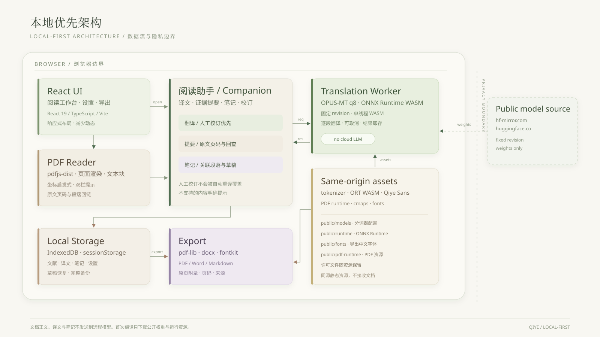

# 架构说明

栖页是一个静态单页应用。PDF 解析、翻译、笔记保存和文件导出都发生在浏览器里，没有应用服务器、数据库或云端语言模型端点。

## 一次阅读的数据流

1. 用户在 Web 界面选择 PDF 或粘贴文字。
2. `pdfjs-dist` 在本地解析 PDF，按坐标和版式启发式提取文本块，同时保留页码和章节线索。
3. 选中段落后，界面把段落发给翻译 Worker。
4. Worker 用同源分词器和 OPUS-MT q8 权重生成本地译文，逐段返回。
5. 译文、证据、笔记和设置写入浏览器存储；导出模块读取当前已保存内容，生成文件。
6. 原论文页面只在用户勾选附录时进入导出文件，不会被改绘或翻译图表内的文字。

## 模块边界

| 模块 | 位置 | 职责 |
| --- | --- | --- |
| 应用壳与数据编排 | `src/App.tsx` | 文献库、导入、操作队列、设置、备份、导出快照 |
| 阅读工作台 | `src/Reader.tsx` | 原文分页、段落选择、译文面板、提要、笔记、校订 |
| PDF 解析与渲染 | `src/pdf.ts`, `src/PdfPage.tsx` | 本地 PDF 文档、文本块、页面 canvas、解析提示 |
| 翻译客户端 | `src/engine.ts` | Worker 生命周期、消息协议、超时、取消、浏览器 AI 探测 |
| 翻译 Worker | `src/engine.worker.ts` | 分词器、模型加载、模型推理、分段与结果 |
| 文本与证据 | `src/text.ts` | 文本切分、证据抽取、译后检查、Markdown 生成 |
| 本地存储 | `src/storage.ts` | IndexedDB、备份校验、原子恢复、删除 |
| 导出内容模型 | `src/export-model.ts` | 导出章节、页码范围、换行、文件名与限制 |
| PDF 导出 | `src/export-pdf.ts` | 字体嵌入、正文排版、原页附录、页脚 |
| Word 导出 | `src/export-docx.ts` | 可编辑正文、页码域、原页图片分节 |
| 原页图渲染 | `src/source-pages.ts` | 独立 PDF.js 文档、1800 px 长边 PNG、取消清理 |
| 图片失败保护 | `src/source-image-check.ts` | 检查渲染操作解析出的图片资源，拒绝静默白图 |

## 本地优先与隐私边界

浏览器边界内运行的内容包括界面、PDF.js、翻译 Worker、IndexedDB、sessionStorage 和导出库。文档正文、译文、笔记和文件名不会发送给远程翻译服务。

唯一跨越浏览器边界的外部资源是公开模型权重。权重从 `hf-mirror.com` 获取，失败时尝试 `huggingface.co`，使用固定 revision `4dc37afc6deb160f4c9048260d48019ee497658e`。请求只包含模型文件名和范围，不包含文档内容。页面本身、分词器配置、ONNX Runtime、PDF 资源和导出字体均从同源站点加载。

可选浏览器内置翻译或摘要能力由浏览器厂商管理，不属于核心链路；项目不会自动切换到收费云端模型。

## PDF 阅读

- `pdfjs-dist` 使用同源 worker、字体、CMap 和 WASM 资源。
- 文件限制为 30 MiB 和 100 页；加密或受限制的 PDF 会明确拒绝。
- 文本块按坐标行、列间距和字号聚合；对疑似双栏、重叠、旋转或非横排文字给出解析提示。
- 不执行 OCR。扫描页仍可查看原 PDF，但没有可信文字时不会生成摘要。
- 原 PDF 页面使用 canvas 渲染，DPR 上限为 2，渲染任务在页面切换时取消。

## 本地翻译

- Worker 是单例，并发请求会被拒绝，不会创建额外 Worker 或中断已有请求。
- 分词器从同源 `public/models/onnx-community/opus-mt-en-zh/` 读取；模型使用 `AutoModelForSeq2SeqLM.from_pretrained` 和 `dtype: 'q8'`、`device: 'wasm'`。
- 长段按 token 数递归切分，单次输入不超过 512 token，输出上限 384 token；疑似截断时进一步拆分或明确失败。
- 结果只保留 `text` 和 `engine`，避免内部消息字段污染严格备份结构。
- 人工校订标记为 `人工校订`，自动翻译会跳过该段；校订后再次点击翻译不会覆盖。
- 首次模型下载约 290 MB，运行时占用内存；推荐桌面浏览器。模型缓存可复用，但不承诺永久离线。
- 进程错误、运行时错误、超时和取消都会终止 Worker，下一次请求可重新创建。

## 存储与恢复

IndexedDB 数据库为 `qiye-library-v1`，对象仓库为 `papers`、`files` 和 `settings`。文献和原 PDF 在同一原子事务中保存或删除。备份导出从三个仓库读取同一份快照，严格校验版本、字段、ID、引用和 PDF Base64 总量；恢复在事务外解码，再用一个事务合并。

完整备份包含原 PDF、正文、译文、笔记和设置。恢复时同 ID 文献会被覆盖，其他文献保留；备份未附 PDF 时会清除本机同 ID 的旧文件，避免复用错误文件。

手写笔记草稿保存在 sessionStorage，按文献 ID 隔离，每次输入同步暂存。刷新或返回后可恢复；提交保存后只清除对应版本，避免旧保存覆盖新输入。

当前没有跨标签页并发冲突解决。重要内容应定期导出完整备份。

## 导出

导出先取只读快照。`export-model.ts` 生成章节、来源页码和叙述性提示，PDF 和 Word 各自排版。原页附录只复制用户选择的页面，保留完整页面，不做自动裁图。

PDF 使用完整嵌入的中文字体，避免子集化在部分 CJK 字符上缺字。多页原始 PDF 通过一次 `copyPages` 批量复制，共享图片和字体只嵌入一次。页数、页码范围、字体字符和输出大小都在导出前检查。

Word 正文是可编辑 OOXML，附录是 1800 px 长边 PNG 整页图，按原页方向放入独立分节。导出不会请求 Word 自动更新所有域，避免打开时触发不必要的外部内容提示。渲染出的图片资源会经过检查，损坏图片会停止导出而不是生成白页。

更完整的格式、限制与验收步骤见 [导出设计](EXPORT.md)。

## 失败处理

- 缺原 PDF 时，附录选项会明确失败，不会静默省略。
- 原 PDF 实际页数与文献记录不一致时停止导出，避免附错页面。
- 图片解码失败或图片资源为空时停止 Word 导出并提示。
- 导出可取消；取消后不下载文件，已保存的阅读内容不受影响。
- 超过正文、图片或输出大小限制时提示分批导出，不偷偷降低质量或丢图。
- 页码格式、页数范围、缺失内容和不支持字符在生成前校验。

## 测试

`npm test` 运行 54 项回归检查，覆盖：

- 备份结构、ID 引用、PDF 归属、Base64、设置和大小边界；
- 文本切分、Unicode 代理对、证据抽取和译后检查；
- Worker 结果净化、错误、并发、取消、监听清理和畸形消息；
- 导出章节、页码解析、换行和文件名；
- PDF 图片依赖失败保护；
- 生产构建和 TypeScript 检查在 `npm run build` 中完成。

测试不能证明所有设备、所有 PDF 版式和所有专业术语都正确；它证明的是已定义的边界行为可以被重复检查。
